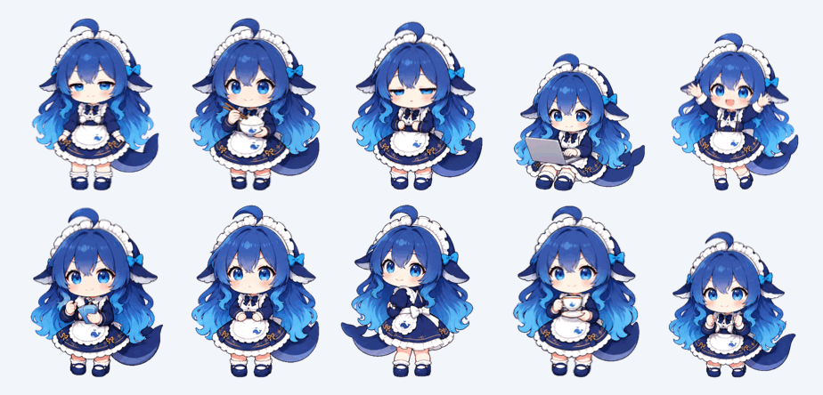
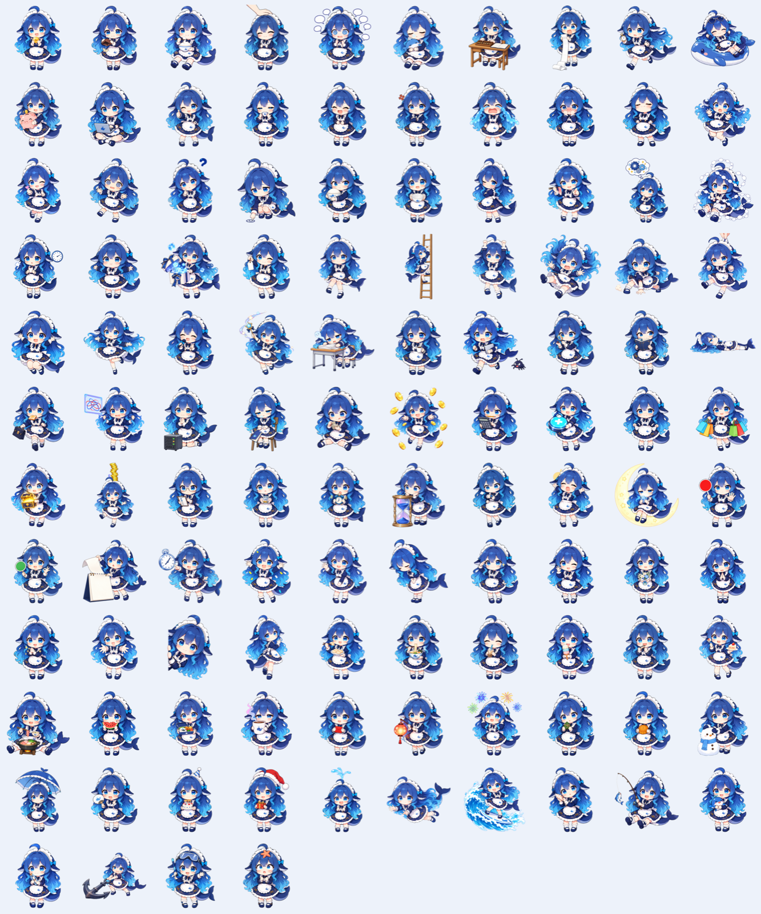

# 🐋 WhaleSeek · 화면 구석에 사는 AI 사용량 고래 소녀 (Mac 네이티브 버전)

[简体中文](README.md) · [English](README.en.md) · [繁體中文](README.zh-TW.md) · [日本語](README.ja.md) · **한국어** · [Español](README.es.md) · [Français](README.fr.md) · [Deutsch](README.de.md) · [Português](README.pt-BR.md) · [Русский](README.ru.md)

Mac 화면 구석에 사는 DeepSeek 고래 소녀입니다. 말풍선에 DeepSeek 잔액, 오늘 사용액, 피크 / 비피크 전환까지 남은 시간을 보여 줍니다. [DSH 잔액 고래 위젯](https://github.com/MeteorNOX/DeepSeek-Balance-Whale-Widget)을 Mac 네이티브로 옮긴 버전이며 DeepSeek Harness가 필요 없습니다.




> 커뮤니티에서 만든 비공식 팬 프로젝트입니다. DeepSeek와는 관련이 없으며 보증을 받지 않았습니다.
>
> 이전 이름은 WhaleBalance이며 v0.0.6부터 WhaleSeek로 바뀌었습니다. 이전 버전에서 업그레이드하면 설정, 장부, API 키가 자동으로 옮겨집니다.

## 기능

- **잔액**: DeepSeek API 키로 잔액을 조회하고 60초마다 자동 새로 고침하며, 캐릭터를 클릭하면 바로 새로 고칩니다. 총잔액, 보너스, 충전 잔액을 따로 표시할 수 있습니다.
- **오늘 사용액**: 잔액 감소분을 사용액으로 누적합니다. 충전은 따로 기록되어 사용액을 상쇄하지 않으며, 어느 날이든 직접 보정할 수 있습니다. API 키마다 장부가 따로 생깁니다.
- **장부 창**: 오늘, 최근 7일, 전체 기록. 날짜별 상세 내역, 날짜나 모델 이름 검색, 사용 구성 그래프를 제공합니다.
- **피크 / 비피크**: 평일 9–12시와 14–18시(베이징 시간)가 피크이고, 주말과 중국 공휴일은 종일 비피크입니다. 초 단위 카운트다운을 포함한 5가지 표시 스타일이 있습니다.
- **말풍선 사용자 지정**: 클릭 순서, 가중치 A/B 추첨. 텍스트, 링크, 랜덤 대사, 이미지, 잔액, 오늘 사용액, 피크 상태, 다른 업체, Codex 사용량 모듈이 있고, 모듈마다 글자 크기, 색, 흐르는 그라데이션, 글꼴을 설정할 수 있습니다.
- **알림**: 잔액 부족과 오늘 예산 알림. 알림 내용은 자유롭게 편집할 수 있습니다.
- **다른 업체**: 34개 템플릿. OpenRouter, Kimi, StepFun, Novita 잔액, Zhipu, Kimi Coding, MiniMax, OpenCode Go 구독 한도, OpenAI 호환 게이트웨이를 지원합니다. 키는 각 템플릿의 공식 엔드포인트로만 전송되며, 사용자 지정 주소는 직접 허용해야 합니다.
- **Codex 통계**: 로컬 Codex 세션 기록에서 토큰 사용량과 구독 기간을 집계합니다. 네트워크를 사용하지 않습니다.
- **Mac 네이티브**: 자유롭게 드래그하면 화면 가장자리에 붙고, 왼쪽에 붙으면 좌우가 뒤집힙니다. 메뉴 막대에 잔액 표시, 로그인 시 자동 실행, API 키는 키체인에 저장됩니다.
- **구독과 API 비용**: 이 Mac의 cswap(Claude 계정별 5시간, 7일, 추가 사용량, 모델별 한도), Claude Code 요금제와 토큰 사용량, Codex의 ChatGPT 요금제를 자동으로 감지합니다. 조직 Admin 키를 넣으면 OpenAI API와 Claude API 비용도 표시합니다.
- **자동 재생**: 1–3분마다 스스로 움직이거나 말풍선을 띄우거나 사용량을 알려 줍니다. 작은 동작마다 겹치지 않는 대사 5개가 붙어 있습니다. 피크/오프피크 전환, 구독 사용량 임계값 초과와 초기화도 알려 줍니다. 전체 화면, 회의 중, 자리 비움, 야간에는 조용히 있고, 자동 재생은 소리를 내지 않습니다.
- **AI가 만든 동작**: 아트 파이프라인으로 만든 프레임 애니메이션 10개(기지개, 밥 먹기, 졸기, 타이핑, 춤, 돈 세기 등)가 기존 동작과 함께 무작위로 재생됩니다.

옮기지 않은 기능: 턴별 비용, 작업 종료음, 질문 / 승인 알림, 대화 이름 모듈. 이 기능들은 DeepSeek Harness 내부 이벤트에 의존하므로 독립 앱에서는 가져올 수 없습니다.

## 설치

macOS 13 이상이 필요합니다. Apple 실리콘과 Intel Mac 모두에서 작동합니다.

### 방법 1: 명령어 한 줄로 설치 (추천)

"터미널"을 열고 아래 한 줄을 붙여 넣은 뒤 Return 키를 누르세요.

```bash
curl -fsSL https://raw.githubusercontent.com/jianzhou0420/whaleseek/main/install.sh | bash
```

앱이 `~/Applications`에 설치되고 바로 실행됩니다.

### 방법 2: 직접 다운로드

1. [Releases](https://github.com/jianzhou0420/whaleseek/releases/latest)에서 `WhaleSeek-macOS.zip`을 다운로드한 뒤 더블 클릭해 압축을 풉니다.
2. `WhaleSeek.app`을 "응용 프로그램" 폴더로 드래그합니다.
3. 처음 열 때 앱이 공증되지 않았기 때문에 macOS가 "개발자를 확인할 수 없습니다"라고 표시합니다. 이렇게 하면 열 수 있습니다.
   - `WhaleSeek.app`을 **오른쪽 클릭**하고 "열기"를 선택한 다음, 다시 "열기"를 클릭합니다.
   - 그래도 열리지 않으면 터미널에서 다음을 실행합니다.
     ```bash
     xattr -dr com.apple.quarantine /Applications/WhaleSeek.app
     ```

### 방법 3: 소스에서 직접 빌드

Xcode 또는 Xcode 명령어 도구가 필요합니다. 없다면 `xcode-select --install`을 실행하세요.

```bash
git clone https://github.com/jianzhou0420/whaleseek.git
cd whaleseek
./build.sh
open WhaleSeek.app
```

처음 실행하면 설정 창이 열립니다. DeepSeek API 키를 붙여 넣고 저장하세요. 키는 macOS 키체인에만 저장됩니다.

## 사용법

| 이렇게 하면 | 이렇게 됩니다 |
|---|---|
| 캐릭터 클릭 | 잔액을 새로 고치고 잔액 말풍선을 표시 |
| 말풍선 클릭 | 다음 항목(랜덤 대사와 이미지)을 표시하고 마지막 항목 뒤에 닫힘 |
| 캐릭터 드래그 | 위치 이동, 놓으면 가까운 가장자리에 붙음 |
| 캐릭터 오른쪽 클릭, ⋯ 버튼, 또는 메뉴 막대의 🐳 | 메뉴: 크기, 효과음, 말풍선, 붙이기, 장부, 설정, 종료 |

## 아트 에셋 파이프라인

`art-pipeline/`은 Codex CLI에 내장된 이미지 생성 기능으로 고래 소녀의 새 포즈를 한꺼번에 만듭니다. API 키 대신 ChatGPT 구독 한도를 씁니다. 배경 제거, 가장자리 정리, 이미지별 품질 검사, 불합격 이미지 재생성을 자동으로 하고, 합격한 이미지를 앱의 내장 갤러리에 넣습니다. `art-pipeline/assets.json`에 새 포즈를 적고 다음을 실행하세요.

```bash
codex login
./art.sh all
```

`./art.sh anim`은 `art-pipeline/anims.json`에 따라 프레임 애니메이션을 생성합니다. 이미지 한 장에 6프레임을 그리고, 자동으로 잘라 발 위치에 맞춰 정렬하고 일관성을 검사합니다. `./art.sh anim-install`로 앱에 넣습니다.

이미지 한 장에 약 40초가 걸립니다. 이미지 생성은 텍스트보다 Codex 한도를 3–5배 빨리 씁니다.



첫 버전의 돌아다니는 데스크톱 펫을 찾으시나요? [v0.0.1 릴리스](https://github.com/jianzhou0420/whaleseek/releases/tag/v0.0.1)에서 받을 수 있습니다.

## 크레디트 및 라이선스

- 기능 설계, 장부 규칙, 업체 템플릿, 기본 대사는 [MeteorNOX/DeepSeek-Balance-Whale-Widget](https://github.com/MeteorNOX/DeepSeek-Balance-Whale-Widget)(MIT)에서 옮겨 왔습니다. 원래 프로젝트의 이미지와 효과음은 MIT 대상이 아니어서 사용하지 않았습니다.
- 캐릭터 아트: [f0909172434/deepseek-girl-codex-pet](https://github.com/f0909172434/deepseek-girl-codex-pet) (MIT).
- `assets/generated`의 이미지는 위 캐릭터를 참고해 아트 파이프라인이 OpenAI의 gpt-image-2로 생성했습니다. 자세한 내용은 [THIRD_PARTY_NOTICES.md](THIRD_PARTY_NOTICES.md)를 참고하세요.
- 이 프로젝트의 코드는 [MIT 라이선스](LICENSE)로 공개되어 있습니다.
