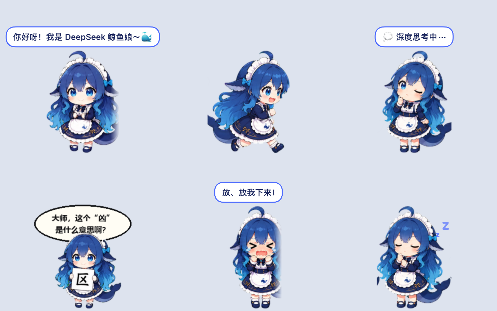

# 🐳 DeepSeek Whale Girl · mascote de área de trabalho para Mac

[简体中文](README.md) · [English](README.en.md) · [繁體中文](README.zh-TW.md) · [日本語](README.ja.md) · [한국어](README.ko.md) · [Español](README.es.md) · [Français](README.fr.md) · [Deutsch](README.de.md) · **Português** · [Русский](README.ru.md)

Uma garota-baleia do DeepSeek que mora na parte de baixo da tela do seu Mac. Ela corre de um lado para o outro, segue o cursor com os olhos, fala quando você clica nela, chora quando você a levanta e, quando fica entediada, começa a "pensar profundamente". Às vezes ela segura uma placa com "区" e pergunta o que "凶" significa.



> Este é um projeto de fãs não oficial. Não tem vínculo com o DeepSeek nem é endossado por ele.

## Instalação

Requer macOS 13 ou posterior. Funciona em Macs com Apple Silicon e Intel.

### Opção 1: instalação com uma linha (recomendada)

Abra o Terminal, cole esta linha e pressione Return:

```bash
curl -fsSL https://raw.githubusercontent.com/jianzhou0420/deepseek-whale-girl-mac/main/install.sh | bash
```

O app é instalado em `~/Applications` e aberto em seguida.

### Opção 2: download manual

1. Baixe `WhaleGirl-macOS.zip` em [Releases](https://github.com/jianzhou0420/deepseek-whale-girl-mac/releases/latest) e clique duas vezes para descompactar.
2. Arraste `WhaleGirl.app` para a pasta Aplicativos.
3. Na primeira vez que você abrir, o macOS vai dizer que não consegue verificar o desenvolvedor, porque o app não é notarizado. Para abrir mesmo assim:
   - Clique com o **botão direito** em `WhaleGirl.app`, escolha **Abrir** e clique em **Abrir** de novo.
   - Se ainda assim não abrir, execute isto no Terminal:
     ```bash
     xattr -dr com.apple.quarantine /Applications/WhaleGirl.app
     ```

### Opção 3: compilar a partir do código-fonte

Você precisa do Xcode ou das Ferramentas de Linha de Comando do Xcode (se não tiver, execute `xcode-select --install`).

```bash
git clone https://github.com/jianzhou0420/deepseek-whale-girl-mac.git
cd deepseek-whale-girl-mac
./build.sh
open WhaleGirl.app
```

## Como brincar

Ela fala chinês. As falas são piadas internas do DeepSeek, como "服务器繁忙，请稍后再试" ("O servidor está ocupado, tente novamente mais tarde").

| Você | Ela |
|---|---|
| Mexe o mouse | Vira a cabeça para o cursor (16 direções) |
| Clica nela | Acena, dá um pulinho, fala algo ou começa a "pensar profundamente" |
| Arrasta ela | Chora "me põe no chão!" e cai de volta quando você solta |
| Clica com o botão direito nela ou em 🐳 na barra de menus | Menu: falar, pensar, mostrar a placa, dormir, voltar ao centro, sair |
| Deixa ela quieta | Passeia, fica no mundo da lua, tira uma soneca e mostra a placa |

Ela não atrapalha. Cliques na área transparente ao redor dela passam direto para a janela de trás.

**Sair**: Clique em 🐳 na barra de menus e escolha 退出鲸鱼娘 (Sair). O app não tem ícone no Dock, então ⌘Q não funciona.

**Abrir de novo**: Procure `WhaleGirl` no Spotlight (⌘ Espaço).

**Desinstalar**: Feche o app e mova `WhaleGirl.app` para o Lixo.

## Personalize

Todo o código está em um único arquivo, [`main.swift`](main.swift):

- As falas e os textos do menu ficam em `enum Lines`.
- Os quadros de animação de cada estado ficam em `struct Anim`.
- A frequência com que ela anda, dorme e fala é definida em `decide()`.

Depois de mudar algo, rode `./build.sh` de novo.

## Créditos e licença

- Atlas de animação da personagem por [f0909172434/deepseek-girl-codex-pet](https://github.com/f0909172434/deepseek-girl-codex-pet) (licença MIT). Veja [`assets/SOURCE.md`](assets/SOURCE.md) e [`assets/LICENSE`](assets/LICENSE).
- O código deste projeto é distribuído sob a [licença MIT](LICENSE).
- O nome e o logotipo do DeepSeek pertencem aos respectivos proprietários.
